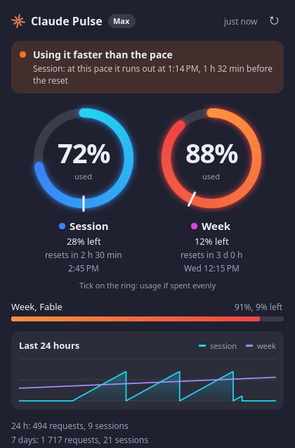
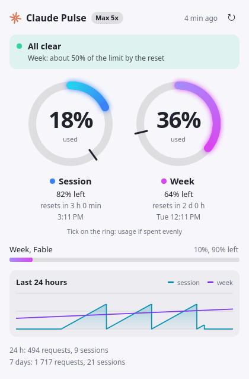

# Claude Pulse

See how much of your Claude Code limits you have used, right on the Linux panel, and get warned before you run out.

[Русская версия](README.ru.md)

<p>
  
  
</p>

Images use sample data. Claude Pulse is an unofficial community project, not affiliated with or endorsed by Anthropic.

## Features

- **Panel icon with two rings.** The outer blue ring is the 5-hour session, the inner violet ring is the week. A ring turns red above 85%. Plans with no 5-hour limit, such as verified Ultra accounts, show only the week. Numbers next to the rings are optional.
- **Dashboard on click.** It shows your current plan, percent used and left, a countdown to each reset, per-model weekly limits and a 24-hour chart.
- **Pace tick.** The tick on each ring marks where you would be if you spent the limit evenly, so you can see at a glance if you are ahead of it.
- **Forecast.** It works out whether you will run out before the reset, and when.
- **Notifications.** You get one alert when a forecast shows you hitting a limit early, and one at each usage threshold (80% and 95% by default).
- **Follows your theme.** Light and dark are both supported, in English and Russian.

## Requirements

- Linux with Python 3.9 or newer
- [Claude Code](https://code.claude.com) logged in with a Claude subscription. API key logins have no such limits to show.
- One of the following:
  - **KDE Plasma 6:** nothing else is needed
  - **Another desktop:** PyQt6 with its QML modules, and a tray that supports StatusNotifier

## Install

```bash
git clone https://github.com/mmukhanov/claude-pulse.git
```

```bash
cd claude-pulse && ./install.sh
```

No root is needed. The installer picks the Plasma widget on Plasma 6 and the tray app everywhere else. On Plasma it also adds the widget to your first panel. You can choose with `--plasma`, `--tray` or `--no-panel`.

For the tray app on Debian or Ubuntu, install the dependencies first:

```bash
sudo apt install python3-pyqt6 python3-pyqt6.qtquick qml6-module-qtquick qml6-module-qtquick-layouts qml6-module-qtquick-window
```

On GNOME, the tray also needs the [AppIndicator extension](https://extensions.gnome.org/extension/615/appindicator-support/).

To update, run `git pull` and `./install.sh` again, then restart the shell on Plasma:

```bash
systemctl --user restart plasma-plasmashell
```

To uninstall, run `./uninstall.sh`. Add `--purge` to delete settings and history as well.

## Using it

Click the icon to open the dashboard. Hover over it for a short summary. An orange dot on the icon means a limit is forecast to run out before it resets.

**To hide the numbers on Plasma:** right-click the widget, choose **Configure Claude Pulse**, and untick **Show numbers next to the rings**. The tray app always shows only the rings, because tray icons cannot hold text.

## Notifications

Each alert fires once per limit window and resets with the window.

| Alert | When it fires |
| --- | --- |
| Risk of hitting the limit | The straight-line forecast reaches 100% before the reset, at least 15% of the window has passed, and at least 20% of the limit is used |
| Usage threshold | Usage crosses a value in `thresholds`. 95% and above is sent as critical |

The forecast assumes you keep spending at your average rate so far in the window. It is an estimate: taking a break makes it too pessimistic, and a heavy burst after a quiet start makes it too optimistic.

## Settings

Optional file: `~/.config/claude-pulse/config.json`. Invalid values are ignored. Plasma picks up language and refresh changes after the next update or a shell restart.

```json
{
  "language": "auto",
  "interval_minutes": 5,
  "notifications": true,
  "thresholds": [80, 95],
  "risk_alerts": true,
  "risk_min_percent": 20,
  "claude_path": ""
}
```

| Key | Meaning |
| --- | --- |
| `language` | `auto`, `en` or `ru` |
| `interval_minutes` | Time between updates, from 1 to 60 |
| `notifications` | Turns all alerts on or off |
| `thresholds` | Usage percentages that trigger an alert |
| `risk_alerts` | Turns forecast alerts on or off |
| `risk_min_percent` | No forecast alerts below this usage |
| `claude_path` | Absolute path to `claude` if it isn't on `PATH` |

## How it works

Every few minutes Claude Pulse runs Claude Code's own command and parses the text it prints:

```bash
claude -p /usage --output-format json --no-session-persistence --strict-mcp-config
```

This uses no tokens and counts against no limit. The same collector works from a terminal or in your own scripts:

```bash
python3 package/contents/code/fetch.py --text
```

Without `--text` it prints JSON, which you can feed to Waybar, Polybar or anything else.

## Security and privacy

- **No access to your login.** It never reads `~/.claude/.credentials.json` or any token. Claude Code handles its own login. The plan name comes from `claude auth status`, and only that one field is kept.
- **No network code.** Only the `claude` command it starts talks to Anthropic, as it always does. There is no telemetry.
- **Only numbers are stored.** `~/.local/state/claude-pulse` holds percentages, reset times, request and session counts, and it is readable only by you. Your prompts and conversations are never read or stored.
- **Limited side effects.** The command runs in that private folder, so no project's settings or hooks apply. It saves no session and starts no MCP servers.
- **Output is treated as untrusted.** It is shown as plain text and escaped in notifications, and invalid settings are ignored.
- **No root.** Everything installs into your home folder.

See [SECURITY.md](SECURITY.md) to report a problem.

## Limitations

- `/usage` output is meant for people, not programs, so a Claude Code update could change it. If that happens the dashboard says so and keeps the last known numbers. The parsing lives in one small function.
- Tested on Ubuntu 26.04 with Plasma 6.6 on Wayland. The tray app has only had a basic start-up check on Plasma, so reports from other desktops are welcome.
- On Wayland the tray popup may not open next to the icon, because apps can't choose their own window position there.

## Troubleshooting

| What you see | What to do |
| --- | --- |
| "claude not found" | Set `claude_path` in the settings. The panel may have a shorter `PATH` than your terminal |
| "Not logged in to Claude Code" | Run `claude` and log in |
| "This login has no subscription limits" | You are using an API key or similar. Log in with a Claude subscription |
| "No limits in /usage output" | Run `claude`, then `/usage`. If limits show there, the format changed, so please open an issue |
| Old version after updating | Run `systemctl --user restart plasma-plasmashell` |
| No notifications | Check that `notify-send` is installed |

## Development

```bash
python3 -m unittest discover -s tests
```

`tools/render_preview.py <folder>` renders every state with sample data, without needing a Plasma shell.

## Related projects

These helped shape the idea and may suit you better:
[claude-usage](https://github.com/utajum/claude-usage),
[ClaudeStatusBar](https://github.com/mkalmousli/ClaudeStatusBar),
[claude-usage-widget](https://github.com/bozdemir/claude-usage-widget),
[cc-cockpit](https://pypi.org/project/cc-cockpit/),
[ClaudeUsageBar](https://github.com/Artzainnn/ClaudeUsageBar) (macOS),
[claude-meter](https://github.com/aki77/claude-meter) (macOS).

## License

[MIT](LICENSE)
