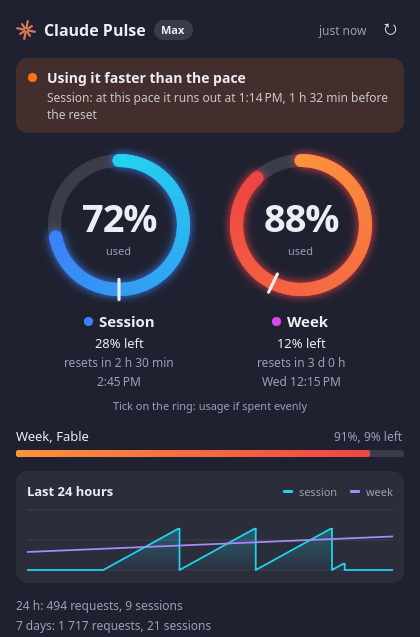
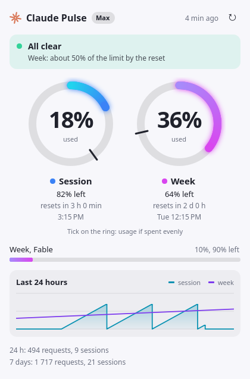

# Claude Pulse

Показывает на панели Linux, сколько лимитов Claude Code уже израсходовано, и предупреждает, пока они не кончились.

[English version](README.md)

<p>
  
  
</p>

На картинках примерные данные. Claude Pulse — неофициальный проект сообщества, не связанный с Anthropic.

## Возможности

- **Значок с двумя кольцами.** Внешнее синее кольцо — сессия на 5 часов, внутреннее фиолетовое — неделя. Выше 85% кольцо становится красным. На тарифах без лимита на 5 часов, например на подтверждённых аккаунтах Ultra, показывается только неделя. Цифры рядом с кольцами можно скрыть.
- **Окно по клику.** В нём текущий тариф, проценты использованного и остатка, отсчёт до сброса, недельные лимиты по моделям и график за 24 часа.
- **Риска темпа.** Риска на кольце показывает, сколько ушло бы при ровном расходе, так что сразу видно, идёте ли вы быстрее.
- **Прогноз.** Показывает, кончится ли лимит до сброса и когда именно.
- **Уведомления.** Одно приходит, когда прогноз показывает, что лимит кончится раньше сброса, и ещё по одному на каждом пороге (по умолчанию 80% и 95%).
- **Следует за темой.** Поддерживает светлую и тёмную темы, русский и английский языки.

## Что нужно

- Linux и Python 3.9 или новее
- [Claude Code](https://code.claude.com) с входом по подписке Claude. При входе по API-ключу таких лимитов нет.
- Одно из двух:
  - **KDE Plasma 6:** больше ничего не требуется
  - **Другой рабочий стол:** PyQt6 с модулями QML и трей с поддержкой StatusNotifier

## Установка

```bash
git clone https://github.com/mmukhanov/claude-pulse.git
```

```bash
cd claude-pulse && ./install.sh
```

Права root не нужны. На Plasma 6 установщик ставит виджет и добавляет его на первую панель, на остальных столах ставит приложение для трея. Выбрать вручную можно ключами `--plasma`, `--tray` и `--no-panel`.

Для приложения в трее на Debian или Ubuntu сначала поставьте зависимости:

```bash
sudo apt install python3-pyqt6 python3-pyqt6.qtquick qml6-module-qtquick qml6-module-qtquick-layouts qml6-module-qtquick-window
```

В GNOME для трея нужно ещё [расширение AppIndicator](https://extensions.gnome.org/extension/615/appindicator-support/).

Чтобы обновить, выполните `git pull` и снова `./install.sh`, а на Plasma затем перезапустите оболочку:

```bash
systemctl --user restart plasma-plasmashell
```

Чтобы удалить, запустите `./uninstall.sh`. С ключом `--purge` удалятся и настройки с историей.

## Как пользоваться

Клик по значку открывает окно, наведение показывает краткую сводку. Оранжевая точка на значке значит, что по прогнозу лимит кончится раньше сброса.

**Как скрыть цифры на Plasma:** щёлкните виджет правой кнопкой, выберите настройку Claude Pulse и снимите флажок **Показывать цифры рядом с кольцами**. В трее видны только кольца, потому что значок трея не вмещает текст.

## Уведомления

Каждое приходит один раз за окно лимита и сбрасывается вместе с ним.

| Уведомление | Когда приходит |
| --- | --- |
| Риск упереться в лимит | Линейный прогноз доходит до 100% раньше сброса, прошло не меньше 15% окна и использовано не меньше 20% лимита |
| Порог расхода | Расход пересёк значение из `thresholds`. От 95% уведомление критическое |

Прогноз считает, что вы и дальше тратите со средней скоростью с начала окна. Это оценка: после перерыва она будет слишком мрачной, а после резкого рывка в конце спокойного периода — слишком оптимистичной.

## Настройки

Необязательный файл: `~/.config/claude-pulse/config.json`. Неверные значения игнорируются. Plasma применит язык и частоту обновления после следующего обновления данных или перезапуска оболочки.

```json
{
  "language": "auto",
  "interval_minutes": 5,
  "notifications": true,
  "thresholds": [80, 95],
  "risk_alerts": true,
  "risk_min_percent": 20,
  "claude_path": ""
}
```

| Ключ | Что значит |
| --- | --- |
| `language` | `auto`, `en` или `ru` |
| `interval_minutes` | Минут между обновлениями, от 1 до 60 |
| `notifications` | Включает или выключает все уведомления |
| `thresholds` | Проценты расхода, на которых приходит уведомление |
| `risk_alerts` | Включает или выключает уведомления по прогнозу |
| `risk_min_percent` | Ниже этого расхода уведомлений по прогнозу нет |
| `claude_path` | Абсолютный путь к `claude`, если его нет в `PATH` |

## Как это работает

Раз в несколько минут Claude Pulse запускает команду самого Claude Code и разбирает её текстовый вывод:

```bash
claude -p /usage --output-format json --no-session-persistence --strict-mcp-config
```

Токены на это не тратятся, лимит не расходуется. Тот же сборщик работает из терминала и в ваших скриптах:

```bash
python3 package/contents/code/fetch.py --text
```

Без `--text` он выводит JSON, который можно передать в Waybar, Polybar и другие программы.

## Безопасность и приватность

- **Нет доступа ко входу.** Программа не читает `~/.claude/.credentials.json` и другие токены. Вход полностью остаётся за Claude Code. Название тарифа берётся из `claude auth status`, и сохраняется только это поле.
- **Нет сетевого кода.** С Anthropic общается только запущенная команда `claude`, как и обычно. Телеметрии нет.
- **Хранятся только числа.** В `~/.local/state/claude-pulse` лежат проценты, время сброса, число запросов и сессий, и читать их можете только вы. Ваши запросы и переписка не читаются и не сохраняются.
- **Минимум побочных эффектов.** Команда запускается в этой закрытой папке, поэтому настройки и хуки проектов не действуют. Сессия не сохраняется, MCP-серверы не запускаются.
- **Вывод считается недоверенным.** Он показывается как обычный текст и экранируется в уведомлениях, неверные настройки игнорируются.
- **Без root.** Всё ставится в домашнюю папку.

О проблемах безопасности сообщайте по инструкции в [SECURITY.md](SECURITY.md).

## Ограничения

- Вывод `/usage` рассчитан на людей, а не на программы, поэтому обновление Claude Code может его изменить. Тогда окно сообщит об этом и сохранит последние данные. Разбор вывода собран в одной небольшой функции.
- Проверено на Ubuntu 26.04 с Plasma 6.6 на Wayland. Приложение для трея прошло только простую проверку запуска на Plasma, поэтому отчёты с других столов очень пригодятся.
- На Wayland окно из трея может открыться не рядом со значком, потому что там приложения не выбирают положение своих окон.

## Если что-то не так

| Что вы видите | Что сделать |
| --- | --- |
| «не найден claude» | Укажите `claude_path` в настройках. У панели `PATH` может быть короче, чем в терминале |
| «no limits in /usage output» | Запустите `claude`, затем `/usage`. Если лимитов нет, значит вход выполнен не по подписке |
| После обновления старая версия | Выполните `systemctl --user restart plasma-plasmashell` |
| Нет уведомлений | Проверьте, что установлен `notify-send` |

## Разработка

```bash
python3 -m unittest discover -s tests
```

`tools/render_preview.py <папка>` рисует все состояния на примерных данных, оболочка Plasma для этого не нужна.

## Похожие проекты

Они помогли с идеей и, возможно, подойдут вам больше:
[claude-usage](https://github.com/utajum/claude-usage),
[ClaudeStatusBar](https://github.com/mkalmousli/ClaudeStatusBar),
[claude-usage-widget](https://github.com/bozdemir/claude-usage-widget),
[cc-cockpit](https://pypi.org/project/cc-cockpit/),
[ClaudeUsageBar](https://github.com/Artzainnn/ClaudeUsageBar) (macOS),
[claude-meter](https://github.com/aki77/claude-meter) (macOS).

## Лицензия

[MIT](LICENSE)
