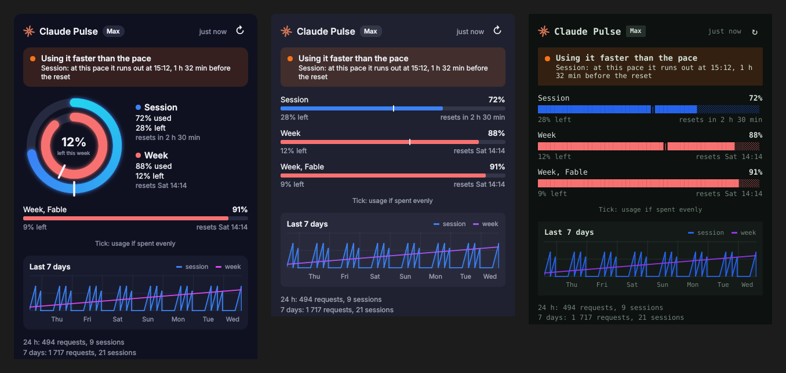
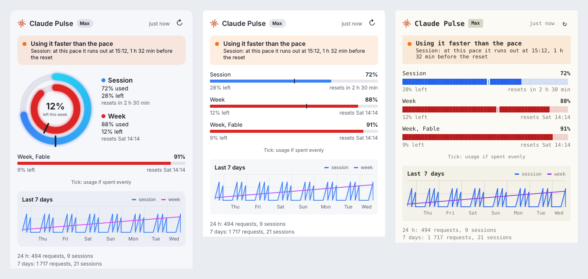

# Claude Pulse for Windows

See how much of your Claude Code limits you have used, right in the Windows system tray, and get warned before you run out.

The Windows version of [Claude Pulse](../README.md) (Linux / KDE Plasma). [Русская версия](README.ru.md)

<p></p>
<p></p>
<p></p>

Images use sample data. Claude Pulse is an unofficial community project, not affiliated with or endorsed by Anthropic.

## Features

- **Tray icon.** The outer ring (or upper bar) is the 5-hour session, the inner ring (or lower bar) the week. A mark turns red above 85%. An orange dot means a limit is forecast to run out before it resets. Hover for a short summary.
- **Dashboard on click.** Plan, percent used and left, a countdown to each reset, per-model weekly limits and a 7-day chart. It opens next to the tray, wherever your taskbar is.
- **Pace tick and forecast.** The tick shows where you would be if you spent the limit evenly; the forecast says whether and when you will run out before the reset.
- **Windows notifications.** One alert when the forecast shows you hitting a limit early, and one at each usage threshold (80% and 95% by default).
- **Five themes** (Orbit, Lines, Terminal, Battery, Paper), light, dark or following Windows. English and Russian.
- **Starts with Windows.** Turned on at first run; switch it off in the tray menu.

## Requirements

- Windows 10 or 11
- [Claude Code](https://code.claude.com) installed and logged in with a Claude subscription. API key logins have no such limits to show.

## Install

### Ready-made exe

1. Download `ClaudePulse.exe` from [Releases](https://github.com/mmukhanov/claude-pulse/releases) or from the latest successful run under **Actions → windows → Artifacts**.
2. Put it anywhere, for example `%LOCALAPPDATA%\Programs\ClaudePulse\`, and run it.

The exe is not code-signed, so SmartScreen may warn on first start: click **More info → Run anyway**. If you'd rather not trust a binary, build it yourself or run from source (below).

The icon may land in the hidden-icons overflow (the `^` arrow). Drag it onto the taskbar to keep it visible, or turn it on in **Settings → Personalization → Taskbar → Other system tray icons**.

### From source

Needs Python 3.10+ from [python.org](https://www.python.org/downloads/windows/).

Without git: download [the repository as a zip](https://github.com/mmukhanov/claude-pulse/archive/refs/heads/main.zip), unpack it to a permanent place (autostart points to it) and use its `windows` folder. With git:

```bat
git clone https://github.com/mmukhanov/claude-pulse.git
```

```bat
cd claude-pulse\windows && py -m pip install -r requirements.txt
```

```bat
pyw claude_pulse.pyw
```

### Build the exe yourself

```bat
py -m pip install -r requirements.txt pyinstaller && py -m PyInstaller --noconfirm claude-pulse.spec
```

The result is `dist\ClaudePulse.exe`.

## Using it

- **Left click** the tray icon: open or close the dashboard.
- **Right click**: refresh, theme, appearance, language, start with Windows, settings file, quit.

## Settings

Optional file: `%APPDATA%\claude-pulse\config.json` (tray menu → *Open settings file*). Invalid values are ignored.

```json
{
  "language": "auto",
  "theme": "orbit",
  "color_mode": "system",
  "interval_minutes": 5,
  "notifications": true,
  "thresholds": [80, 95],
  "risk_alerts": true,
  "risk_min_percent": 20,
  "claude_path": ""
}
```

| Key | Meaning |
| --- | --- |
| `language` | `auto`, `en` or `ru` |
| `theme`, `color_mode` | `orbit`, `lines`, `terminal`, `battery` or `paper`, and `system`, `light` or `dark` |
| `interval_minutes` | Time between updates, from 1 to 60 |
| `notifications` | Turns all alerts on or off |
| `thresholds` | Usage percentages that trigger an alert |
| `risk_alerts` | Turns forecast alerts on or off |
| `risk_min_percent` | No forecast alerts below this usage |
| `claude_path` | Full path to `claude.exe` or `claude.cmd` if it isn't found automatically, e.g. `C:\\Users\\you\\.local\\bin\\claude.exe` |

Without `claude_path` it looks on `PATH`, then in `%USERPROFILE%\.local\bin\claude.exe` (native installer) and `%APPDATA%\npm\claude.cmd` (npm).

## How it works

Every few minutes Claude Pulse runs Claude Code's own command, hidden, and parses the text it prints:

```bat
claude -p /usage --output-format json --no-session-persistence --strict-mcp-config
```

This uses no tokens and counts against no limit. The same collector works from a terminal:

```bat
py -m claude_pulse --text
```

`py -m claude_pulse --json` prints JSON for your own scripts.

## Security and privacy

- **No access to your login.** It never reads `%USERPROFILE%\.claude\.credentials.json` or any token. The plan name comes from `claude auth status`, and only that one field is kept.
- **No network code.** Only the `claude` command it starts talks to Anthropic. No telemetry.
- **Only numbers are stored**, in `%LOCALAPPDATA%\claude-pulse`: percentages, reset times, request and session counts. Prompts and conversations are never read or stored.
- **Limited side effects.** The command runs in that private folder, so no project's settings or hooks apply. It saves no session and starts no MCP servers.
- **No admin rights.** Autostart uses the per-user `HKCU\...\Run` key.

## Uninstall

Turn off *Start with Windows* in the tray menu, quit, delete the exe. To remove settings and history too, delete `%APPDATA%\claude-pulse` and `%LOCALAPPDATA%\claude-pulse`.

## Limitations

- `/usage` output is meant for people, not programs, so a Claude Code update could change it. If that happens the dashboard says so and keeps the last known numbers.
- Built and smoke-tested in CI on `windows-latest`; the parsing is unit-tested on Windows and Linux. Reports from real machines are welcome.

## Troubleshooting

| What you see | What to do |
| --- | --- |
| "claude not found" | Set `claude_path` in the settings |
| "Not logged in to Claude Code" | Run `claude` in a terminal and log in |
| "This login has no subscription limits" | You are using an API key. Log in with a Claude subscription |
| "This Claude Code can't run /usage with -p" or "Unknown skill: usage" | Update Claude Code: `claude update`. Older versions such as 2.1.100 don't run `/usage` in print mode |
| "No limits in /usage output" | Run `claude`, then `/usage`. If limits show there, the format changed: please open an issue |
| No icon visible | Check the hidden-icons overflow (`^`) next to the clock |
| No notifications | Check *Settings → System → Notifications* and Focus Assist / Do not disturb |

## Development

```bat
py -m unittest discover -s tests
```

`py tools\render_preview.py <folder>` renders every dashboard state with sample data.

## License

[MIT](../LICENSE)
